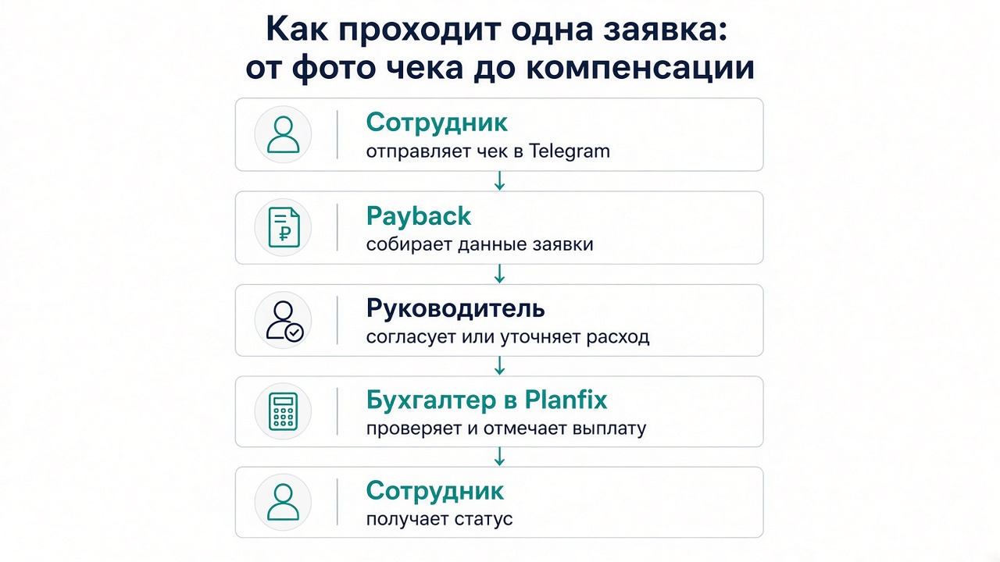
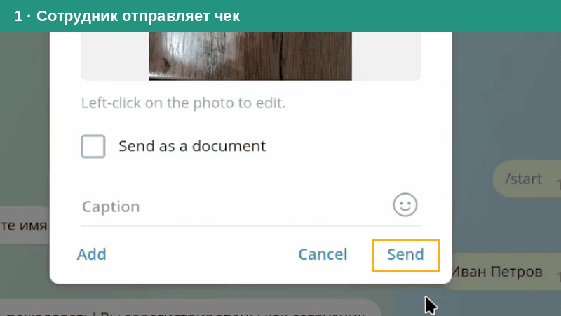
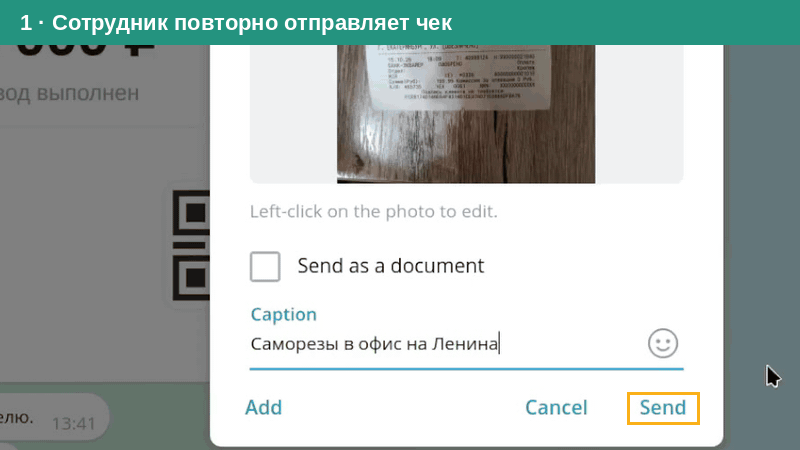
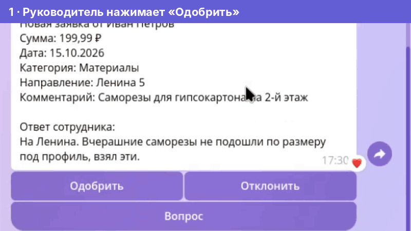

# Payback — согласование расходов через Telegram и Planfix

Payback связывает полевых сотрудников и офис: чек уходит в Telegram, руководитель согласует кнопкой, бухгалтер ведёт заявку до выплаты в Planfix. Полевым не нужно платное место в CRM — достаточно мессенджера.

## Как проходит заявка



### 1. Отправка чека

Сотрудник отправляет чек в Telegram — бот считывает данные QR-кода.



### 2. Проверка повторной подачи

Если чек уже есть в системе, бот не создаёт повторную заявку.



### 3. Согласование

Руководитель принимает решение в Telegram, а заявка отражается в Planfix.



## Возможности

- Сотрудник подаёт расход с фото чека или без чека (`/noreceipt`)
- Руководитель одобряет, отклоняет или задаёт уточняющий вопрос в Telegram
- Бухгалтер работает с карточкой в Planfix: доработка, выплата, компенсация
- QR-код чека → сумма и дата; проверка повторной подачи по фискальным данным
- Двусторонняя синхронизация статусов между ботом и Planfix

## Технологии

| Слой | Стек |
|------|------|
| Бот | Python 3.12+, aiogram 3 |
| API / вебхуки | FastAPI |
| Данные | SQLAlchemy (async), Alembic, PostgreSQL |
| Интеграция | Planfix REST API |
| Запуск | Docker Compose, Caddy (HTTPS) |

## Документация

| Документ | Для кого |
|----------|----------|
| [docs/spec.md](docs/spec.md) | Подробная спецификация |
| [docs/deploy.md](docs/deploy.md) | Развёртывание |
| [docs/planfix_setup/setup.md](docs/planfix_setup/setup.md) | Настройка объекта в Planfix |
| [docs/payback_lifecycle_telegram_bot_planfix.jpg](docs/payback_lifecycle_telegram_bot_planfix.jpg) | Техническая схема lifecycle |

Внутренние черновики (`docs/plan.md`, заметки по API Planfix) в публичный репозиторий не входят.

## Быстрый старт (разработчик)

Нужны Docker Compose и файл окружения по образцу [`.env.example`](.env.example) (токен бота, Planfix, `DOMAIN`, `WEBHOOK_SECRET`).

```bash
# секреты лучше держать вне репозитория
mkdir -p ~/.config/payback
cp .env.example ~/.config/payback/env
# заполните BOT_TOKEN, Planfix, WEBHOOK_SECRET, DOMAIN, …

export PAYBACK_ENV_FILE=$HOME/.config/payback/env
docker compose up --build -d
curl -fsS "https://$DOMAIN/health"
```

Локальная разработка без полного compose: `make db-up`, затем `make run` / `make test`. Подробности — в [docs/deploy.md](docs/deploy.md).

> Не коммитьте `.env`, токены и реальные чеки. Для локальных тестов без Planfix смотрите флаги `DEV_MODE` / `ALLOW_DEV_MODE` в `.env.example` — только вне production.

## Статус

Рабочая реализация согласования расходов (Telegram + Planfix).  
Лицензия: [MIT](LICENSE).
